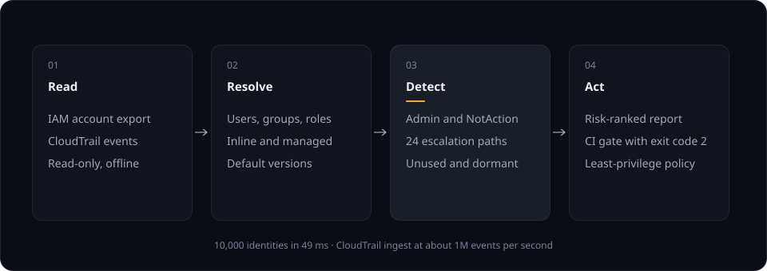
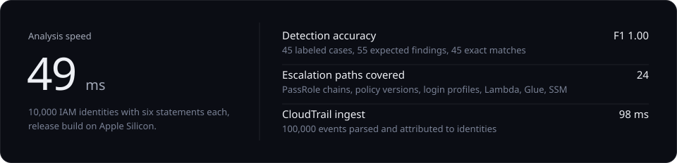

<p align="center">
  
</p>

# IAMLadder: AWS IAM privilege-escalation finder and least-privilege generator

**IAMLadder finds every path to admin in your AWS account and cuts it.** It reads the standard IAM export and your CloudTrail logs, then ranks users and roles by escalation risk. It flags full admins, 24 known privilege-escalation paths, wildcards, dormant identities and unused permissions, and writes the **least-privilege IAM policy** each identity actually needs.

<p>
  <a href="#quick-start"></a>
  <a href="#what-it-finds"></a>
  <a href="#accuracy-and-performance"></a>
  <a href="#use-it-as-a-ci-gate"></a>
  <a href="https://crates.io/crates/iamladder"></a>
  <a href="LICENSE"></a>
</p>

[Quick start](#quick-start) · [What it finds](#what-it-finds) · [Least privilege](#generate-a-least-privilege-policy) · [CI gate](#use-it-as-a-ci-gate) · [Benchmarks](#accuracy-and-performance) · [FAQ](#faq)

---

## Why cloud security teams run it

| The problem | What IAMLadder does |
|---|---|
| Nobody can say which identities could become admin | Evaluates 24 escalation primitives (`iam:PassRole` + `ec2:RunInstances`, `iam:CreatePolicyVersion`, `lambda:UpdateFunctionCode` and more), including wildcards, globs and explicit denies |
| Admin access spreads through groups and old managed policies | Resolves users, groups, inline policies and the default version of every managed policy into effective grants per identity |
| Roles are granted far more than they use | Compares grants with successful CloudTrail calls and reports what was never used |
| Least privilege stays a slide, not a policy | Generates the IAM policy from observed activity, scoped to resource ARNs when CloudTrail recorded them |
| Risky changes ship through pipelines | `--fail-on high` exits with code 2, so a pull request can't add an escalation path |

## See it work

<p align="center">
  
</p>

## Quick start

```bash
cargo install iamladder

# Read-only export; needs iam:GetAccountAuthorizationDetails
aws iam get-account-authorization-details --output json > auth.json

# CloudTrail is optional and enables the unused-permission and activity checks
iamladder analyze --auth auth.json --cloudtrail trail.json
```

Try it on the bundled example account:

```bash
iamladder analyze --auth examples/authorization-details.json \
  --cloudtrail examples/cloudtrail.json --now 2026-11-25
```

## What it finds

| Rule | Severity | Example evidence |
|---|---|---|
| `full_admin` | Critical | `group:Admins/managed:AdministratorAccess` |
| `privesc_*` (24 paths) | High | `iam:PassRole via inline:deploy`, `ec2:RunInstances via inline:deploy` |
| `allow_not_action` | High | `Allow` + `NotAction: iam:*` grants every future service |
| `service_wildcard` | High for `iam`, `sts`, `kms`, `organizations`, `secretsmanager`; Medium otherwise | `dynamodb:* via inline:app` |
| `dormant_principal` | Medium | `role last used 1057 days ago` |
| `unused_permissions` | Medium when at least half is unused, Low otherwise | `5 of 7 explicitly granted actions were never used (71%)` |
| `no_observed_activity` | Low | No successful calls in the CloudTrail window |

<details>
<summary><b>All 24 escalation paths</b></summary>

`CreatePolicyVersion` · `SetDefaultPolicyVersion` · `PassRole + RunInstances` · `CreateAccessKey` · `CreateLoginProfile` · `UpdateLoginProfile` · `AttachUserPolicy` · `AttachGroupPolicy` · `AttachRolePolicy + AssumeRole` · `PutUserPolicy` · `PutGroupPolicy` · `PutRolePolicy + AssumeRole` · `AddUserToGroup` · `UpdateAssumeRolePolicy + AssumeRole` · `PassRole + Lambda CreateFunction + InvokeFunction` · `PassRole + Lambda CreateFunction + CreateEventSourceMapping` · `Lambda UpdateFunctionCode` · `PassRole + Glue CreateDevEndpoint` · `Glue UpdateDevEndpoint` · `PassRole + CloudFormation CreateStack` · `PassRole + Data Pipeline` · `PassRole + ECS RegisterTaskDefinition + RunTask` · `PassRole + SageMaker notebook` · `SSM SendCommand`

These follow the public research from Rhino Security Labs and Bishop Fox.
</details>

Each identity gets a 0–100 risk score. Critical findings count 50, high 25, medium 10 and low 3, capped at 100.

## Generate a least-privilege policy

```bash
iamladder least-privilege --cloudtrail trail.json \
  --principal arn:aws:iam::111122223333:user/build-bot
```

```json
{
  "Version": "2012-10-17",
  "Statement": [
    { "Sid": "Observed1", "Effect": "Allow", "Action": ["ec2:DescribeInstances"], "Resource": "*" },
    { "Sid": "Observed2", "Effect": "Allow", "Action": ["s3:PutObject"],
      "Resource": ["arn:aws:s3:::artifacts-prod/builds/app.sha256", "arn:aws:s3:::artifacts-prod/builds/app.tar.gz"] }
  ]
}
```

Failed calls (`AccessDenied`) are excluded, API version suffixes such as `UpdateFunctionCode20150331v2` are normalized, and actions sharing a resource set are merged into one statement.

## Use it as a CI gate

```yaml
- name: IAM escalation check
  run: iamladder analyze --auth auth.json --format json --fail-on high > iam-report.json
```

| Flag | Purpose |
|---|---|
| `--format json` | Machine-readable report for SIEM, ticketing or dashboards |
| `--fail-on high` | Exit code `2` when any finding is at or above the severity |
| `--dormant-days 90` | Inactivity threshold for roles |
| `--now YYYY-MM-DD` | Reproducible reports |
| `--explain` | Adds an executive summary from any OpenAI-compatible LLM (`OPENAI_API_KEY`, `OPENAI_BASE_URL`, `LLM_MODEL`). Only finding metadata is sent, never policy documents |

## How it works

<p align="center">
  
</p>

## Accuracy and performance

<p align="center">
  
</p>

| Metric | Result |
|---|---|
| Escalation and over-permission detection, 45 labeled cases, 55 expected findings | Precision **1.00**, recall **1.00**, 45/45 exact matches |
| Analyze 10,000 identities with 6 statements each | **49 ms** |
| Same, with CloudTrail usage | **65 ms** |
| Ingest 100,000 CloudTrail events | **98 ms** |

`datasets/privesc_cases.json` covers every path plus wildcards, globs (`iam:Put*Policy`), `NotAction`, explicit and resource-scoped denies, case-insensitive actions and incomplete paths that must not fire. Labels follow AWS IAM semantics. The suite proves the implemented rules are correct; it doesn't measure techniques IAMLadder doesn't know about.

```bash
cargo test                      # unit, end-to-end and accuracy gate
cargo run --release -- eval     # accuracy table
cargo bench                     # performance
```

## FAQ

<details>
<summary><b>Does IAMLadder need write access to AWS?</b></summary>

No. It reads files you export with read-only permissions and never calls AWS itself.
</details>

<details>
<summary><b>How is it different from IAM Access Analyzer?</b></summary>

Access Analyzer is a managed AWS service. IAMLadder runs offline on an export, explains *which* escalation path an identity has and through which policy, ranks identities by risk and can fail a CI job. Many teams use both.
</details>

<details>
<summary><b>Are SCPs, permission boundaries and conditions evaluated?</b></summary>

Not yet. Results are a conservative upper bound on effective access: conditional allows still count, and conditional denies don't block a path.
</details>

<details>
<summary><b>How long should the CloudTrail window be?</b></summary>

30 to 90 days, so monthly and quarterly jobs show up before you remove permissions.
</details>

## Roadmap

- SCPs, permission boundaries and resource-based policies
- Condition-key evaluation for `iam:PassedToService`
- Graph export of escalation paths across assumable roles

## CI

The workflow at `ci/github-actions.yml` runs fmt, clippy, tests, the accuracy gate and coverage. Copy it to `.github/workflows/ci.yml` to enable it.

## License

MIT
